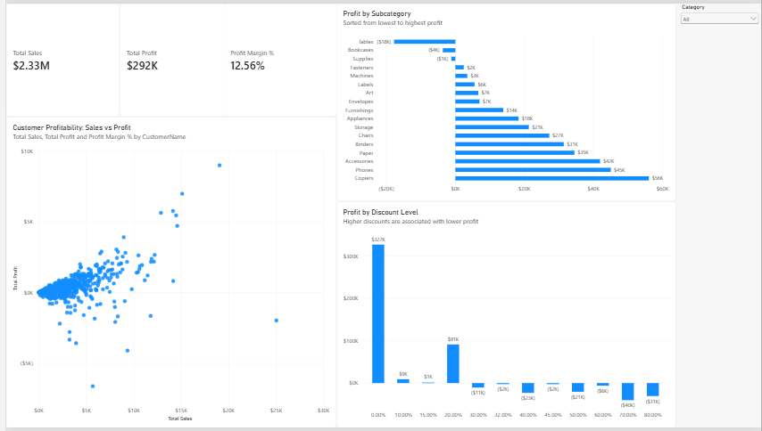
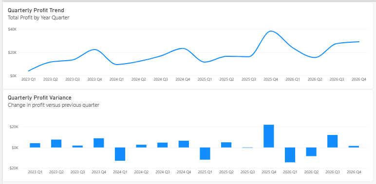
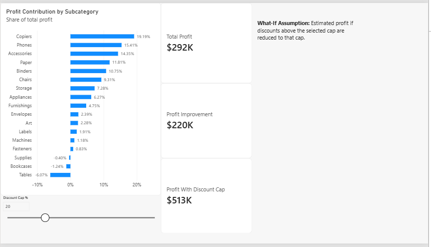

# Retail Profitability Analysis

## Overview

This project analyzes sales, profit, discounting, customer profitability, quarterly trends, and product-level contribution using SQL Server and Power BI.

The goal is to identify the main drivers of profit, locate unprofitable products and customers, evaluate discount risk, and test a practical discount-cap scenario.

## Tools Used

- SQL Server Developer
- Power BI Desktop
- Excel / source spreadsheets
- Git
- GitHub

## Dataset

The analysis uses the Superstore sample data imported into the SQL Server database:

`project3_profitability`

Main tables:

- `orders_clean`
- `returns`
- `people`

The working Orders dataset contains approximately 10,195 rows.

## Key Metrics

- Total Sales: **$2.33M**
- Total Profit: **$292K**
- Overall Profit Margin: **12.56%**

## Key Findings

### Category Profitability

Technology and Office Supplies are the strongest categories.

- Technology margin: approximately **17.45%**
- Office Supplies margin: approximately **17.22%**
- Furniture margin: approximately **2.61%**

Furniture is the weakest category by a large margin.

### Unprofitable Subcategories

The main loss-making Furniture subcategories are:

- Tables: approximately **-$17.8K profit**
- Tables margin: approximately **-8.53%**
- Bookcases: approximately **-$3.6K profit**

### Discount Risk

Discounting has a strong relationship with profitability.

Lower discounts are generally profitable, while higher discount levels increasingly produce losses.

The analysis indicates that discounts above roughly **20%** are frequently associated with weaker or negative profit.

### Customer Profitability

High sales do not always mean high profitability.

One example is **Sean Miller**, who generated strong sales but negative profit because of a heavily discounted transaction involving the Cisco TelePresence EX90.

### What-If Discount Cap

A Power BI what-if parameter was used to estimate the effect of limiting discounts.

At a **20% discount cap**:

- Current Profit: approximately **$292K**
- Estimated Profit Improvement: approximately **$220K**
- Estimated Profit With Discount Cap: approximately **$513K**

This scenario suggests that tighter discount controls could materially improve profitability.

## Business Recommendations

1. Limit routine discounts to approximately **20%** unless a larger discount is specifically justified.
2. Review Tables and Bookcases for pricing, sourcing, and discount-policy problems.
3. Evaluate major customer transactions using profit as well as sales.
4. Monitor high-discount orders before approval.
5. Use quarterly profit and variance trends to identify sudden profitability changes.

## Dashboard Pages

### 1. Profitability Overview



Includes:

- Total Sales
- Total Profit
- Profit Margin
- Customer Sales vs Profit
- Profit by Subcategory
- Profit by Discount Level
- Category slicer

### 2. Trend & Variance



Includes:

- Quarterly Profit Trend
- Quarterly Profit Variance

### 3. Contribution & What-If



Includes:

- Profit Contribution by Subcategory
- Total Profit
- Profit Improvement
- Profit With Discount Cap
- Discount Cap parameter
- What-if assumption note

## Project Structure

```text
retail-profitability-analysis/
├── Retail_Profitability_Analysis.pbix
├── README.md
├── profitability_overview.png
├── trend_variance.png
└── contribution_whatif.png
```

## Portfolio Summary

This project demonstrates:

- SQL-based profitability analysis
- Power BI dashboard development
- KPI design
- Customer and product profitability analysis
- Discount-risk analysis
- Time-series and variance analysis
- What-if scenario modeling
- Business interpretation and recommendations

